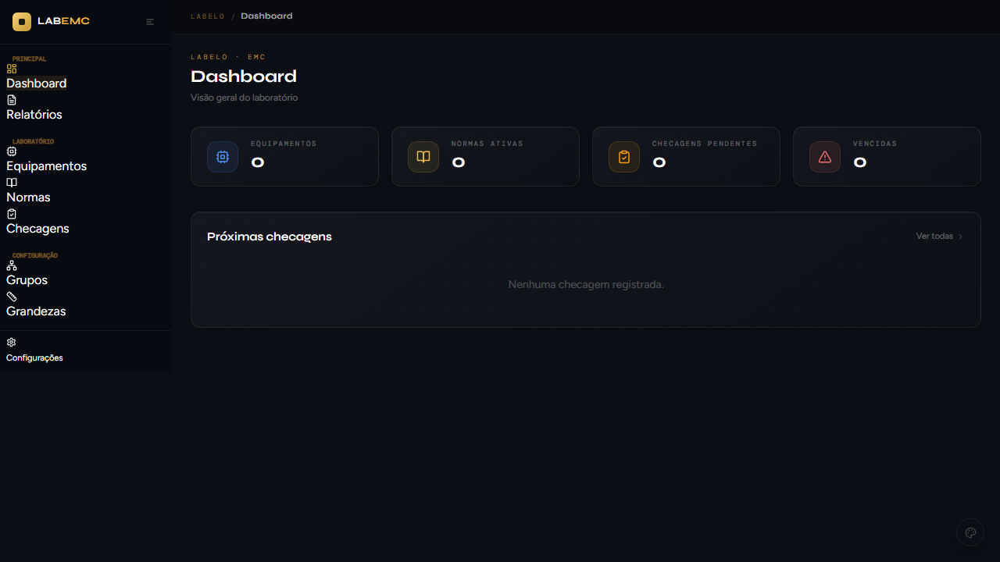
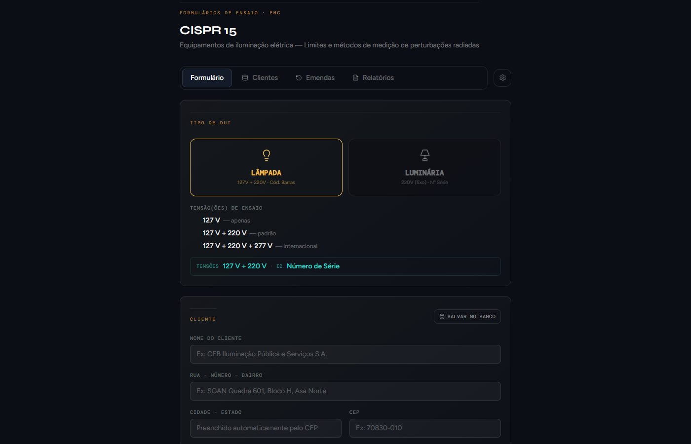
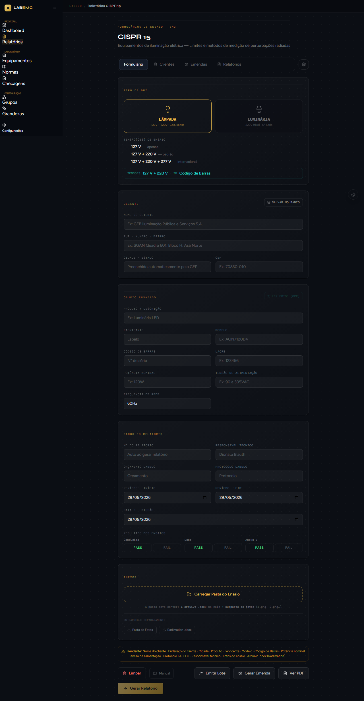
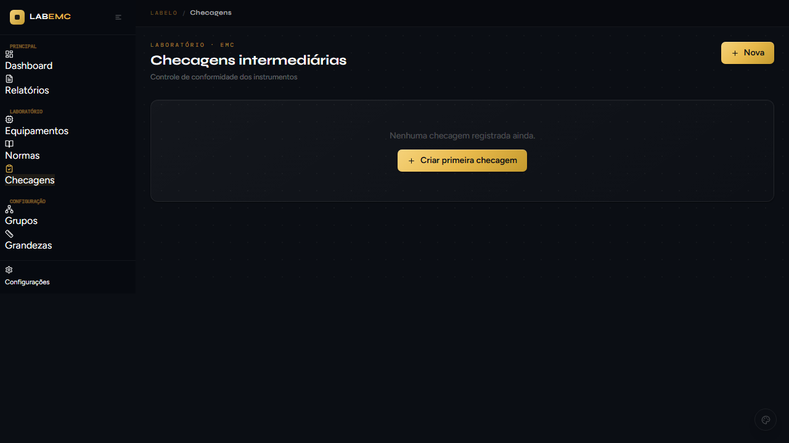
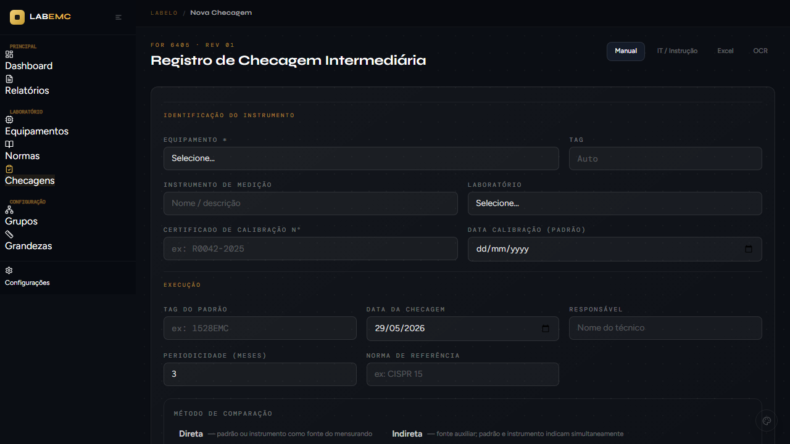
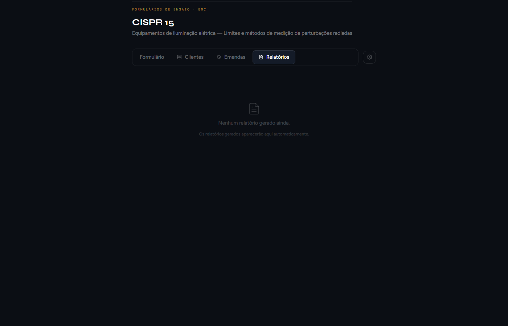
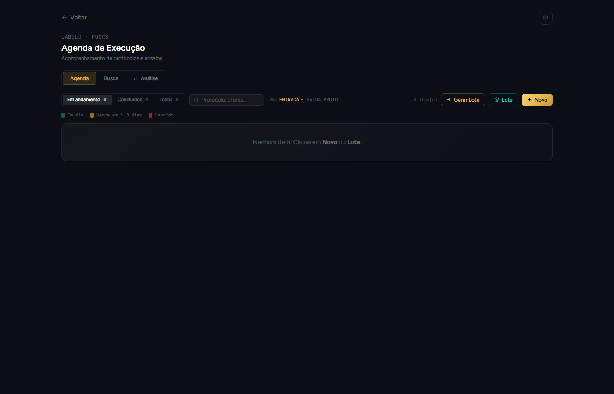
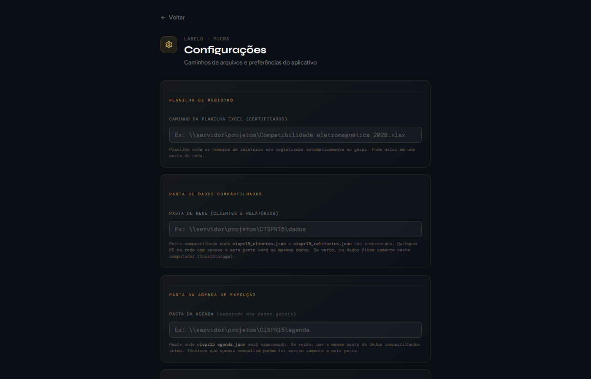

<div align="center">


# CISPR 15 LABELO

**Gestão de ensaios EMC e do controle metrológico do laboratório — LABELO / PUCRS**


</div>

---

## Visão geral

Aplicativo **desktop** (offline, sem servidor) que reúne numa única interface a emissão de relatórios de ensaio
CISPR 15 e a gestão metrológica do laboratório: equipamentos, certificados, checagens intermediárias, normas e
procedimentos. Os dados ficam numa pasta de rede compartilhada, acessível por todos os PCs do laboratório.

> Este é o repositório de **desenvolvimento**. As versões instaláveis são publicadas nas Releases de
> [`rafablauth1/CISPR-15_`](https://github.com/rafablauth1/CISPR-15_/releases), consultadas pelo menu
> **Ajuda → Verificar atualizações**, e também podem ser distribuídas pela pasta de atualização na rede.

## Módulos

| Módulo | Descrição |
|---|---|
| **CISPR 15** | Formulário de ensaio (lâmpada/luminária), geração de PDF, registro em Excel, emendas, lote e banco de clientes |
| **Agenda** | Acompanhamento de protocolos com status de prazo, importação de resultados e fotos pela pasta do protocolo e emissão em lote |
| **Dashboard** | Relatórios por mês, análise de emendas por motivo, checagens pendentes e vencidas |
| **Equipamentos** | Inventário por grupo e subgrupo, com cadastro separado de **auxiliares** (acopladores, redes, fontes) sem rastreabilidade própria |
| **Certificados** | Pontos 1D e grade 2D (frequência × nível), com importação de certificados de **outros laboratórios** e identificação automática do emissor |
| **Checagens** | Checagens intermediárias com periodicidade, rastreabilidade e pontos marcados direto no certificado |
| **Planos de calibração** | Por equipamento: grandezas, pontos de calibração e critério de aprovação (%, valor fixo e ppm) |
| **Normas** | Biblioteca normativa (CISPR 15/11/32, IEC 61000-4-x, NBR 15947) com PDF |
| **Procedimentos** | Editor de IT/PC e checagem por certificado com interpolação |
| **Grandezas, laboratórios e glossário** | Cadastros de apoio e taxonomia metrológica |

## Telas

### Dashboard do laboratório



Equipamentos cadastrados, normas ativas, checagens pendentes e vencidas e relatórios por mês.

### CISPR 15 — Formulário de ensaio



Tipo de DUT (lâmpada ou luminária), tensões de ensaio e dados do cliente. Campos e limites se adaptam à norma.

### CISPR 15 — Relatório a partir do Word do RadiMation



Importa o `.docx` exportado pelo RadiMation, converte os gráficos WMF/EMF para PNG, processa as tabelas de picos e
gera o PDF final.

### Checagens intermediárias





Ao informar a **TAG do padrão**, o sistema carrega o último certificado e abre o painel para marcar os pontos
(1D ou grade 2D); cada ponto vira um ponto de checagem com grandeza, parâmetro, VR e correção.

### Relatórios salvos



Filtro por cliente e ano, status de aprovação, assinatura digital e cópia dos arquivos para a pasta da EUT.

### Agenda de execução



Status de prazo, entrada e saída de EUTs e emissão em lote com período de início e fim para todas as amostras.

### Configurações



Pastas de dados (inclusive caminhos de rede UNC), PDFs, planilha Excel, atualização, backup e certificado de
assinatura digital.

## Funcionalidades principais

- Relatório CISPR 15 em PDF com **assinatura digital**
- Importação de resultados via **Word (RadiMation)**, **Excel** ou **OCR**
- Conversão automática de gráficos **WMF/EMF → PNG**
- **Revisão obrigatória** antes da emissão e bloqueio de número de relatório ou protocolo repetido
- **Lote**: várias amostras emitidas de uma vez, com a pasta do protocolo identificada automaticamente
- **Emendas** que reabrem completas em qualquer PC
- **Agenda**: "Verificar PDFs" marca como concluído o relatório já assinado na pasta
- **Checagens** com interpolação linear e bilinear sobre os pontos do certificado
- Importação em lote de certificados de outros laboratórios (PT/EN), com extração de TAG, fabricante, modelo e série
- **Corretor ortográfico** pt-BR nos campos de texto
- Dados e **backup automático** na rede, com escrita atômica e cópia `.bak`
- Instalação **sem privilégios de administrador** e atualização sem reinstalar

## Instalação

### Primeira vez

1. Copie a pasta portátil (`win-unpacked`) para o PC — por exemplo, `C:\CISPR15-LABELO\`.
2. Abra `CISPR 15 LABELO.exe`. Não há instalador nem UAC; as configurações ficam em `%APPDATA%\cispr15-labelo` e
   são preservadas nas atualizações.

### Atualizações

**Ajuda → Verificar atualizações** baixa o pacote da versão nova, substitui os arquivos e reinicia o aplicativo.

## Desenvolvimento

Requer **Node.js 18.17+** e Windows.

```bash
npm install

# Modo dev (Next.js + Electron)
npm run dev          # terminal 1 — Next.js na porta 3000
npm run electron     # terminal 2 — Electron
```

Atalhos equivalentes na raiz: `abrir-modo-dev.bat` (com console) e `abrir-modo-dev.vbs` (sem console). Ambos
sobem o servidor se ele ainda não estiver rodando e abrem o app lendo o código-fonte atual.

```bash
# Build
npm run dist                       # next build + electron-builder (NSIS + zip)
npx electron-builder --win dir     # apenas a pasta portátil win-unpacked

# Build + publicação da release
npm run dist:publish
```

> `dist:publish` requer `GH_TOKEN` em `.env.local`, com permissão de escrita em *Contents* do repositório de
> releases.

## Estrutura do projeto

```
app/            rotas Next.js: cispr15, agenda, (lab)/* e api/*
components/     componentes React compartilhados (inclui o corretor ortográfico)
lib/            domínio: checagens, certificados, normas, equipamentos, auxiliares, interpolação
electron/       processo principal, preload, assinatura de PDF e atualização
public/         arquivos estáticos e formulários
assets/         ícones do aplicativo
bin/            wmf2png.exe (conversor WMF/EMF)
build/          installer.nsh (NSIS)
scripts/        etapas de build e utilitários de extração de certificados
tools/          utilitários de desenvolvimento (manual, screenshots, wmf2png)
docs/           manuais (DOCX/PDF) e screenshots
```

## Stack

| Camada | Tecnologia |
|---|---|
| Desktop | Electron 31 |
| Interface | Next.js 14, React 18, Tailwind CSS |
| PDF | Puppeteer Core, assinatura digital (node-forge / @signpdf) |
| Office | Mammoth (DOCX → HTML), xlsx / xlsx-populate |
| OCR | Windows OCR API, Tesseract.js |
| Atualização | GitHub Releases e pasta de rede, com updater próprio (zip) |

---

<div align="center">

Desenvolvido para o **LABELO — Laboratório de Ensaios Elétricos** · PUCRS

</div>
